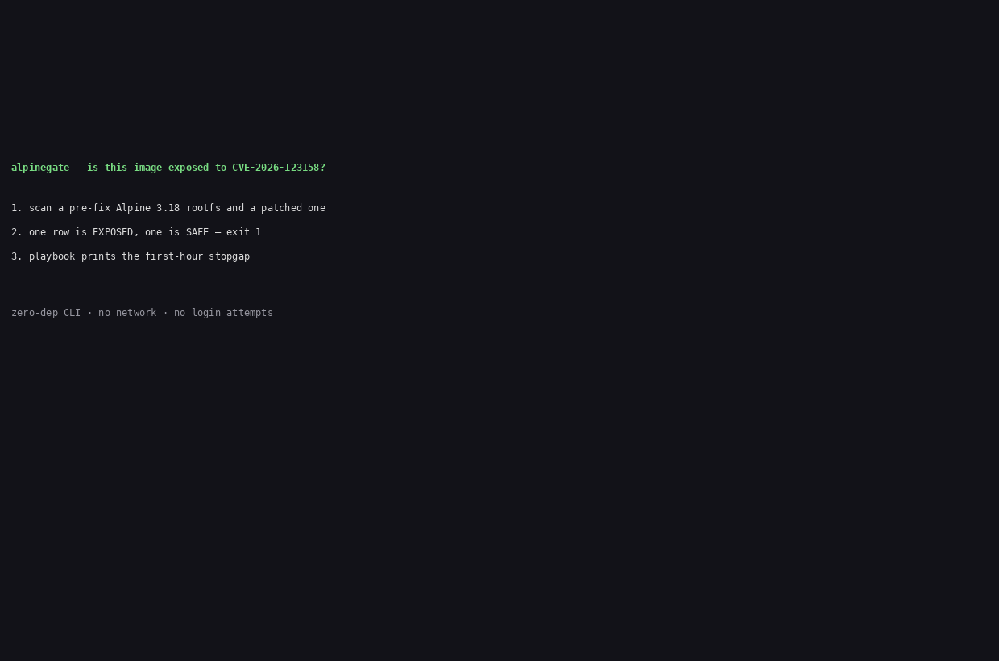

# alpinegate

Check whether your Alpine images and containers are actually exposed to the OpenSSH musl password bypass (CVE-2026-123158) — five live conditions, one verdict, zero network.

On 5 November 2026, OpenSSH shipped emergency release 10.6p2 for a bypass nicknamed "sshole": on Linux systems where `sshd` links against musl libc and runs without PAM, a 257–1024 byte password logs in to any account whose password field is a single `*` — an account that was supposed to never accept any password. Alpine Linux is the common case. A CVE list cannot tell you which of your images is actually exposed. This tool can, in one command.



## The five conditions

A target is **EXPOSED** only when all five hold at the same time (Alpine security advisory, 2026-11-05):

1. **Alpine / musl** — an `/etc/alpine-release` exists.
2. **Vulnerable openssh** — the installed version is below the fixed version for its branch (backported per branch; see the table below).
3. **No PAM** — `openssh-server` built without PAM, or `openssh-server-pam` with `UsePAM no`.
4. **PasswordAuthentication yes** — the OpenSSH default.
5. **A `*` account plus a salt donor** — at least one account with password field exactly `*` (for example `root:*`, shipped since Alpine 3.16), and at least one other account with a `$5$` or `$6$` hash that can supply a salt.

Why it works: musl's `crypt()` returns `"*"` on failure for passwords over 256 bytes, and `"*"` is exactly what the stored field contains for an account with no password — so the comparison succeeds. OpenSSH 10.6p2 refuses stored fields shorter than four characters.

## Install (from source)

npm publishing is pending an owner decision on the registry token. Until then, install from source — three steps:

```sh
git clone https://github.com/techdevfun/alpinegate.git
cd alpinegate
npm install && npm run build
```

Then run it with `node dist/cli.js ...` (or link it: `npm link`).

## Worked example

The repo ships two fixtures built from the real Alpine 3.18.9 minirootfs plus real openssh APKs — one pre-fix, one patched (see `fixtures/PROVENANCE.md` for URLs, digests, and what is synthetic):

```sh
node dist/cli.js scan fixtures/exposed fixtures/patched
```

```
TARGET            ALPINE  OPENSSH    PAM  PASSAUTH  `*` ACCOUNTS  DONOR  VERDICT
----------------  ------  ---------  ---  --------  ------------  -----  -------
fixtures/exposed  3.18.9  9.3_p2-r3  no   yes       root          $6$    EXPOSED
fixtures/patched  3.18.9  9.3_p2-r4  no   yes       root          $6$    SAFE

fixtures/exposed: all five conditions hold: Alpine 3.18, openssh 9.3_p2-r3 < fixed 9.3_p2-r4, no PAM, password auth on, * accounts (root) + $6$ salt donor
fixtures/patched: openssh 9.3_p2-r4 is at or above the fixed version 9.3_p2-r4 for Alpine 3.18
```

Exit code is `1` when any target is EXPOSED, `0` otherwise. Then print the first-hour stopgap for the exposed target:

```sh
node dist/cli.js playbook fixtures/exposed
```

## Usage

```sh
alpinegate scan [targets...] [--format table|json] [--fail-on exposed|at-risk]
alpinegate check <target> [--format table|json]
alpinegate playbook <target>
```

Targets, all read-only and offline:

| Target | What it scans |
|---|---|
| A rootfs directory (or `/` for the live host) | The directory tree as-is |
| An image tarball (`.tar`, `.tar.gz`, `docker save` output) | Layers merged in order, whiteouts applied |
| A local Docker image name (`alpine:3.18`) | Exported read-only via `/var/run/docker.sock`; no registry pull |

Flags: `--format table|json` (default `table`), `--fail-on exposed|at-risk` (default `exposed`; `at-risk` also fails the run on AT-RISK targets, for CI gates).

Exit codes: `0` = no EXPOSED target; `1` = at least one EXPOSED target (or AT-RISK with `--fail-on at-risk`); `2` = usage or config error (unknown flag, no target, unresolvable image, missing Docker socket). An unresolvable target is never reported as SAFE.

## Verdicts

| Verdict | Meaning |
|---|---|
| `EXPOSED` | All five conditions hold. Fix it in the first hour (see `playbook`). |
| `AT-RISK` | A vulnerable openssh version is present, but at least one condition is missing (for example password auth already off). Still patch it — one config change away from exposed. |
| `SAFE` | Patched openssh version, or PAM in use, or no sshd at all. |
| `UNKNOWN` | Not enough data to decide — for example `/etc/shadow` not readable, or not an Alpine rootfs. **UNKNOWN is not SAFE.** |

## Fixed openssh versions per branch

Checked 2026-11-06 against the Alpine advisory (https://alpinelinux.org/posts/2026-11-05-openssh-password-authentication-bypass/) and the OpenSSH 10.6p2 release notes. Alpine did **not** move stable branches to 10.6p2 — each branch got the fix backported onto the version it already shipped. Looking for "10.6p2" on a stable branch is wrong:

| Branch | Fixed openssh version |
|---|---|
| edge | 10.6_p2-r0 |
| 3.24 | 10.3_p1-r2 |
| 3.23 | 10.2_p1-r1 |
| 3.22 | 10.0_p1-r11 |
| 3.21 | 9.9_p2-r1 |
| 3.20 | 9.7_p1-r6 |
| 3.19 | 9.6_p1-r3 |
| 3.18 | 9.3_p2-r4 |
| 3.17 | 9.1_p1-r7 |
| 3.16 | 9.0_p1-r6 |

CVE-2026-123158, CVSS 3.1 score 8.1 (High). Researcher: Özgün Kültekin (Wakefield); write-up at sshhole.com. No confirmed exploitation in the wild reported as of 2026-11-06 (per the Alpine advisory and OpenSSH notes at disclosure; public reproduction labs exist, so treat exposure as urgent anyway).

## The first-hour playbook

`alpinegate playbook <target>` prints the stopgap; it never applies it. In short, from the Alpine advisory:

1. **Close the hole now** — set `PasswordAuthentication no` (drop-in file `/etc/ssh/sshd_config.d/00-no-passwords.conf`; Alpine reads that directory from 3.19 on, older releases need the main file edited too), then `sshd -t && rc-service sshd restart`. Make sure key login works first and keep your current session open.
2. **Upgrade and restart** — `apk upgrade -U -a`, then `rc-service sshd restart`. The upgrade alone does **not** replace the running daemon.
3. **Check whether you were attacked** — `grep 'Accepted password for' /var/log/messages`. Any accepted password login for an account with no password means the machine was compromised.

## Where rivals beat us

- **Trivy and Grype cover thousands of CVEs** across every package in an image; alpinegate covers exactly one exposure shape. Trivy also scans IaC, Kubernetes, secrets, and licenses; alpinegate does none of that. If you want a full CVE list, use Trivy or Grype.
- **Trivy and Grype are database-driven**, so a same-day CVE may not be in their database yet. On the day this CVE landed, a condition checker was not blind in the same way — that is the whole wedge: alpinegate checks the five live conditions from the image itself, with zero network and no database wait, and adds a running-container inventory plus a first-hour playbook that a CVE list does not give you.
- **ssh-audit** audits SSH configuration and policy, but does not detect Alpine/musl, does not check `/etc/shadow`, and does not inventory a fleet.
- **Lynis / OpenSCAP** do broad host hardening audits, but no sshole-specific condition check and no container inventory.

Sources and check dates for the rival claims are in the blueprint's competitor scan (2026-11-06): Trivy 0.76.1 reported zero PHP2Shell findings on `php:8.4.26-fpm` while Grype flagged both (LiveWyer drill, 29 Oct 2026), and reported "Clean" for end-of-life `alpine:3.18` (revisit.tech drill, 20 Oct 2026).

## Honest limits

- The tool checks **conditions, not exploitability**. EXPOSED means the bypass shape is present; it does not prove anyone logged in. Check `/var/log/messages` for that.
- `sshd_config` is read in the **global context only**: directives inside a `Match` block apply to matching users only and are out of scope for v0.1.0. If you use `Match` blocks to disable password auth for some users, verify with `sshd -T`.
- For a static rootfs or image tarball, the tool cannot tell whether the daemon is **currently running** — it reports the installed package and config. For the live host (`/`), it checks `/proc` for a running `sshd`.
- `UNKNOWN` is never reported as SAFE. If the tool cannot read `/etc/shadow`, fix the visibility gap instead of assuming safety.
- The tool never prints a password hash (only the `$5$`/`$6$` type prefix), never attempts an SSH login, ships no exploit code, and never edits a config or restarts a daemon.

## Roadmap

- Registry pull (`scan` a remote image by tag, still read-only).
- Kubernetes inventory (which pods run an exposed image).
- GitHub Action wrapper (see `examples/github-actions.yml` for the CI-gate pattern today).
- `Match`-block-aware config parsing.

## Development

```sh
npm install
npm run build
npm test          # unit + e2e (extracts fixtures from the tarballs first)
npm run test:live # live smoke, soft-skip offline
node scripts/preflight.js
```

Fixtures: `scripts/build-fixtures.py` rebuilds them from the real Alpine 3.18.9 minirootfs and real openssh APKs (needs network; not run by CI). `fixtures/PROVENANCE.md` records every URL, digest, and the two synthetic parts (a `deploy` user with a real `$6$` hash of a random, never-stored password, and apk-database entries generated from the real `.PKGINFO` files).

## License

MIT. See [LICENSE](LICENSE).
